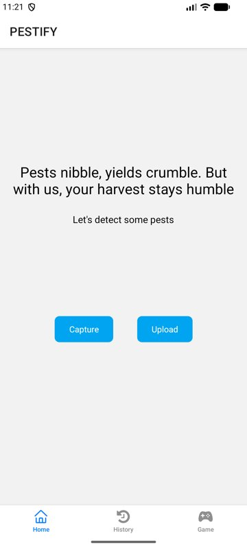
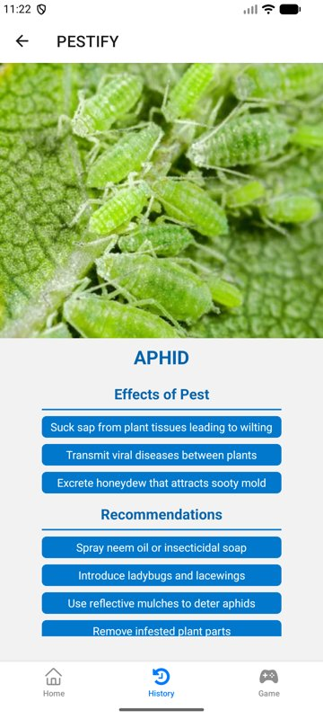
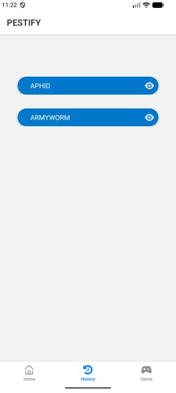
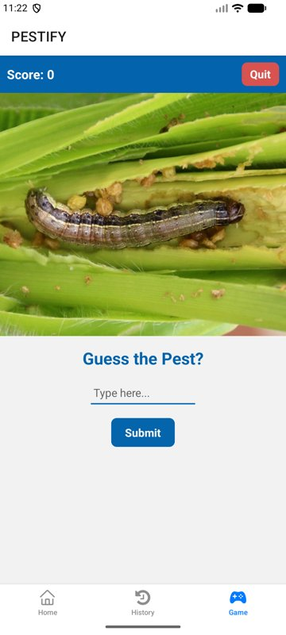

# Pestify

Pestify is a mobile app that helps farmers identify crop pests from a photo. Snap a picture or pick one from the gallery, and a machine-learning model classifies the pest. The app then shows what damage it causes and how to deal with it.

<p align="center">
  
  
  
  
</p>

## Features

- **Detect pests from a photo:** take a picture with the in-app camera or upload one from the gallery. The image is sent to a prediction API and the result comes back in seconds.
- **Pest details:** each detected pest gets a page with a photo, its effects on crops, and recommended control methods.
- **Scan history:** pests you've identified are saved on the device, with the most recent at the top. Tap any entry to see its details again.
- **Guess-the-pest game:** a quiz that shows a pest photo and asks you to name it, with a short fact after each answer.
- **Handles uncertainty:** if the model is not confident the photo contains a known pest, the app asks you to retake the image instead of guessing.

### Supported pests

Aphid · Armyworm · Diamondback moth · Grasshopper · Whitefly

## Tech stack

- [React Native](https://reactnative.dev) with [Expo](https://expo.dev) (SDK 53)
- [Expo Router](https://docs.expo.dev/router/introduction/) for file-based tab and stack navigation
- `expo-camera` and `expo-image-picker` for capturing images
- `@react-native-async-storage/async-storage` for on-device scan history

## How it works

```
 Camera / gallery ──► photo ──► POST /api/predict/ ──► { label, confidence, top_k }
                                  (prediction server)            │
                                                                 ▼
                         History (AsyncStorage) ◄── Pest detail page (pest_info.json)
```

1. The app uploads the photo as `multipart/form-data` to `POST /api/predict/`.
2. The server runs the classification model and returns the top label with its confidence, for example:
   ```json
   { "label": "aphid", "confidence": 0.98, "top_k": [{ "label": "aphid", "confidence": 0.98 }, ...] }
   ```
3. If the label is `unknown`, the app prompts for a new photo. Otherwise it shows the pest's details from [`pest_info.json`](pest_info.json) and saves it to the history.

> **Note:** this repository contains the mobile app only. The prediction server and model live separately: <!-- TODO: link the backend/model repository here -->

## Getting started

### Prerequisites

- Node.js 18 or newer
- An Android emulator (Android Studio) or Android device
- The prediction server running and listening on port `8000`

### Run the app

```bash
npm install
npx expo start
```

Press `a` to open the app on a running Android emulator.

This project uses Expo SDK 53, so it needs the matching Expo Go build. `npx expo start` installs it on an emulator automatically. On a physical Android device, download the SDK 53 version from [expo.dev/go](https://expo.dev/go).

### Point the app at your server

By default the app calls `http://10.0.2.2:8000`, which is how the Android emulator reaches your computer's `localhost`. To use a different server, such as when testing on a physical phone on the same Wi-Fi, create a `.env.local` file:

```bash
EXPO_PUBLIC_API_URL=http://192.168.1.10:8000
```

Then restart with `npx expo start -c` to clear the cache.

## Project structure

```
app/
  main/        Home, camera and pest detail screens
  history/     Scan history list and detail
  game/        Guess-the-pest quiz
components/    Photo preview (sends image to the API), list and subtitle UI
assets/        App icons and pest images
pest_info.json Pest descriptions, effects and recommendations
```

## Possible improvements

- Ship the model on-device so detection works offline
- Add timestamps and the captured photo to history entries
- Support more pest species

<!-- TODO: credit teammates here, e.g.
## Team
- Mawuko Senyo Hayibor: mobile app
- Name: model / backend
-->
